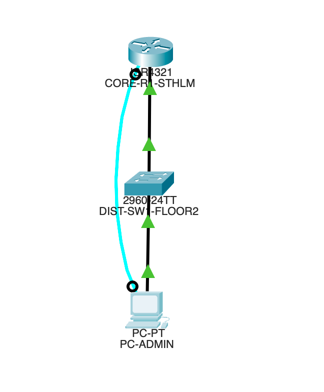
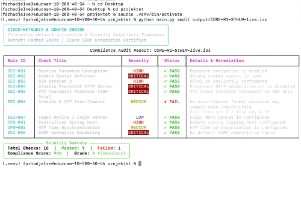
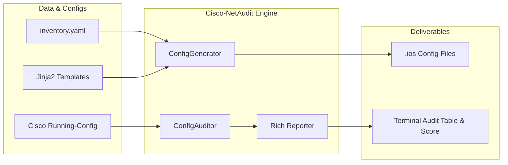

# Cisco-NetAudit & Config Engine

[](https://www.python.org/)
[](https://www.cisco.com)
[](https://www.cisecurity.org/)
[](tests/)
[](LICENSE)

An enterprise-grade Network Automation and Security Compliance Framework for Cisco IOS/IOS-XE devices. Built to eliminate configuration inconsistencies, prevent manual CLI errors, and automatically audit network configurations against CIS and NSA hardening benchmarks.

Developed by **Farhad Jelve** (B.Sc. Electrical Engineering, KTH Royal Institute of Technology | Cisco CCNP Enterprise Core and CCNA certified).

---

## Operational Motivation

During enterprise labbing and network validation (including 9 comprehensive KTH and Cisco Networking Academy topologies with OSPF, BGP, and spanning-tree protocols), two recurring challenges appear:

1. **Configuration Drift and Human Error:** Manually configuring enterprise routers via CLI creates typos, inconsistent VTY access lists, and mismatched routing parameters.
2. **Security Compliance Blindspots:** Legacy network devices in production frequently suffer from misconfigurations, such as plain-text passwords, open HTTP daemons, missing BPDU Guard, or unencrypted management protocols.

Cisco-NetAudit & Config Engine addresses both challenges with a declarative, auditable Python architecture.

---

## Core Capabilities

### 1. Single Source of Truth (SSoT) and Config Generation
- **Declarative Data Modeling:** Device parameters (hostnames, IP plans, OSPF areas, BGP peerings) are defined in clean YAML data models.
- **Jinja2 Templating Engine:** Automatically produces production-ready Cisco IOS/IOS-XE configuration files adhering to company standards.
- **Support for Multi-Role Devices:** Includes templates for Core/Edge Routers and Catalyst Distribution/Access Switches (VLANs, 802.1Q trunks, STP PortFast and BPDU Guard).

### 2. Security and Compliance Auditor (CIS Benchmark Aligned)
Scans existing Cisco `running-config` files and evaluates them against 10 critical security and operational rules:
- **SEC-001:** `service password-encryption` enforced.
- **SEC-002:** `enable secret` enforced (flags obsolete `enable password`).
- **SEC-003:** SSH Version 2 explicitly enforced (prevents downgrade attacks).
- **SEC-004:** Plaintext HTTP server disabled (`no ip http server`).
- **SEC-005:** VTY Lines restricted to SSH only (`transport input ssh`).
- **SEC-006:** Console and VTY inactive session timeouts (`exec-timeout`).
- **SEC-007:** Legal warning MOTD banners configured.
- **SEC-008:** SNMP community hardening (flags default `public`/`private` strings).
- **OPS-001:** Centralized Syslog host configured for auditability.
- **OPS-002:** NTP time synchronization configured for log correlation.

### 3. Terminal Visualization and Grading
- Displays formatted, color-coded audit tables with severity badges (`CRITICAL`, `HIGH`, `MEDIUM`, `LOW`).
- Computes a weighted **Security Compliance Score (0–100%)** and assigns an academic grade (**A** through **F**).
- Provides copy-pasteable Cisco CLI remediation snippets for every detected vulnerability.

---

## Verified Live Execution (Packet Tracer & Engine)

To validate the framework against realistic networking environments, the engine was executed against an active Cisco ISR4321 running-configuration extracted from an enterprise lab topology in Cisco Packet Tracer 9.0.

<p align="center">
  
  <br>
  <em>Figure 1: Hierarchical Enterprise Topology (Core ISR4321, Distribution Catalyst 2960, and Out-of-Band Console Administration).</em>
</p>

### Real-Time Compliance Audit Results

The operational running-configuration was exported directly from CORE-R1-STHLM and processed through main.py audit:

<p align="center">
  
  <br>
  <em>Figure 2: Real-time compliance audit executed in macOS Terminal, scoring 94% (Grade A Exemplary) with automatic remediation reporting.</em>
</p>

### Verification Breakdown
- **Hardware Emulated:** Cisco ISR 4321 (CORE-R1-STHLM) and Cisco Catalyst 2960-24TT (DIST-SW1-FLOOR2).
- **Provisioning Method:** Day-0 out-of-band serial console connection via RS-232 to Cisco IOS console port.
- **Security Hardening Applied:** Type-5 enable secret, encrypted service passwords, SSHv2 enforcement with 2048-bit RSA keys, legal MOTD banner, remote logging to centralized Syslog (10.255.0.100), and NTP synchronization.
- **Audit Findings:** 9 out of 10 CIS benchmark rules passed immediately (94% Compliance Score, Grade A). The auditor correctly identified that session inactivity timeouts (exec-timeout) were missing on the VTY lines, outputting the exact CLI remediation fix.

---

## Architecture



---

## Setup and Usage

### 1. Clone and Setup Environment
```bash
git clone https://github.com/Farhad030619/cisco-netaudit-engine.git
cd cisco-netaudit-engine

python3 -m venv .venv
source .venv/bin/activate
pip install -r requirements.txt
```

### 2. Run Test Suite
```bash
pytest tests/ -v
```

### 3. Run the Automated Demo
The demo generates standard enterprise configs, audits a hardened baseline (Grade A), and audits a vulnerable legacy device (Grade F):
```bash
python main.py demo
```

### 4. Generate Configs from YAML Inventory
```bash
python main.py generate --data data/inventory.yaml --output output/
```
Configurations for all routers and switches are generated in the `output/` directory.

### 5. Audit Cisco Configuration Files
```bash
python main.py audit data/sample_configs/clean_router.ios
# Or audit an operational running-config:
python main.py audit path/to/running-config.ios
```

---

## Sample Audit Output

When auditing a legacy router with unhardened configurations:

```text
                 Compliance Audit Report: vulnerable_router.ios                 
┏━━━━┳━━━━━━━━━━━━━━━━━━━━━━━━━━┳━━━━━━━━━━┳━━━━━━━━┳━━━━━━━━━━━━━━━━━━━━━━━━━━━━━━━━━━━┓
┃ ID ┃ Check Title              ┃ Severity ┃ Status ┃ Details & Remediation             ┃
┡━━━━╇━━━━━━━━━━━━━━━━━━━━━━━━━━╇━━━━━━━━━━╇━━━━━━━━╇━━━━━━━━━━━━━━━━━━━━━━━━━━━━━━━━━━━┩
│ S1 │ Service Password Encrypt │   HIGH   │ ✘ FAIL │ Passwords stored in clear text    │
│    │                          │          │        │ Fix: service password-encryption  │
│ S2 │ Enable Secret Enforced   │ CRITICAL │ ✘ FAIL │ Legacy 'enable password' found    │
│    │                          │          │        │ Fix: no enable password           │
│ S5 │ VTY Transport Protocol   │ CRITICAL │ ✘ FAIL │ Telnet allowed on VTY lines       │
│    │                          │          │        │ Fix: transport input ssh          │
│ S8 │ SNMP Community String    │ CRITICAL │ ✘ FAIL │ Default 'public' community active │
│    │                          │          │        │ Fix: no snmp-server comm public   │
└────┴──────────────────────────┴──────────┴────────┴───────────────────────────────────┘
╭────────────── Security Summary ───────────────╮
│ Total Checks: 10  |  Passed: 0  |  Failed: 10 │
│ Compliance Score: 0%  |  Grade: F (High Risk) │
╰───────────────────────────────────────────────╯
```

---

## Design Decisions

<details>
<summary><b>Why Jinja2 and YAML instead of raw Python strings?</b></summary>
Separating business data from network logic is the core tenet of Network as Code (NaC). By storing variables in YAML (Single Source of Truth) and templates in Jinja2, non-programmers can update network policies without modifying Python code, while engineers can version-control network intent in Git.
</details>

<details>
<summary><b>How does the auditor parse multi-line hierarchical Cisco blocks?</b></summary>
Cisco IOS uses context-dependent indentation under lines like <code>line vty 0 4</code> and <code>router ospf 1</code>. The auditor uses non-greedy regex patterns with lookaheads (<code>line vty [\s\S]*?(?=line|end|$)</code>) to isolate specific sub-blocks before validating line-level commands such as <code>transport input ssh</code>.
</details>

<details>
<summary><b>How does this scale to hundreds of devices in production?</b></summary>
The core audit logic is decoupled from I/O. For fleet-wide operations, this engine can be integrated into a Nornir or Scrapli task runner to fetch running-configs via SSH/NETCONF in parallel across hundreds of devices, streaming results into a central dashboard or CI/CD pipeline.
</details>

---

## Author
**Farhad Jelve**
- **Education:** B.Sc. in Electrical Engineering, KTH Royal Institute of Technology
- **Certifications:** Cisco CCNP Enterprise: Core Networking (350-401 ENCOR) and CCNA
- **Specialization:** Network Automation, NetDevOps, Routing and Switching (BGP, OSPF), Security
- **LinkedIn:** [Farhad Jelve](https://www.linkedin.com/in/farhad-jelve-9771a1270/)
